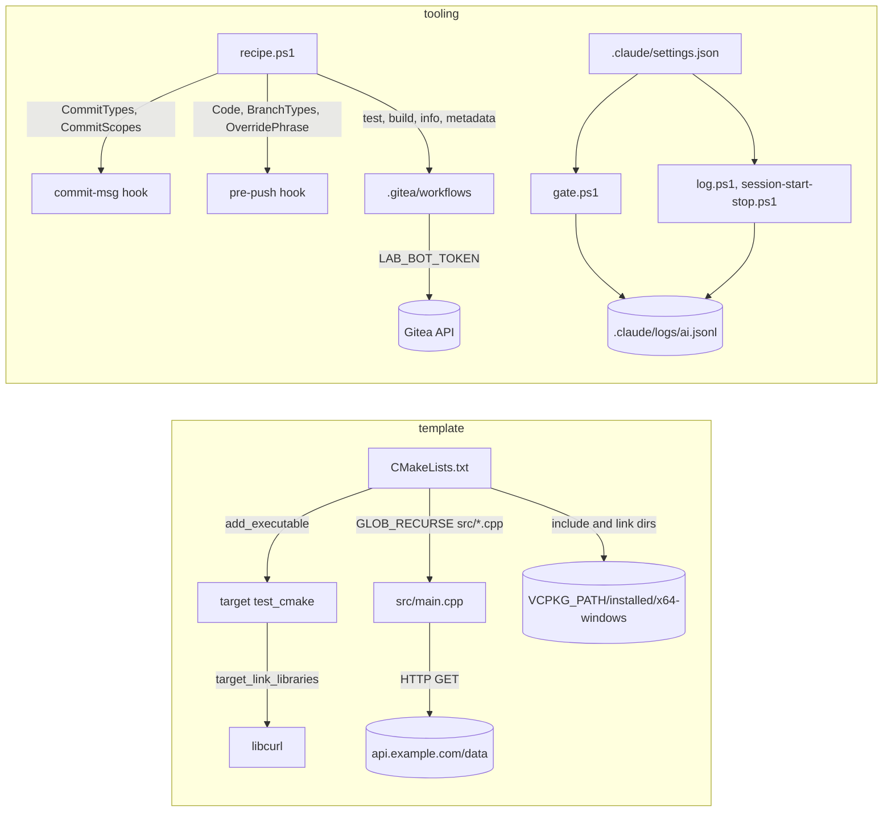

# easy-cmakefile: documentation

easy-cmakefile is an annotated `CMakeLists.txt` from July 2023 for a C++20
project that takes its libraries from vcpkg, with one example source file,
`src/main.cpp`, that sends an HTTP GET request with libcurl. The repository is
a template to copy from and ships no program (`README.md`; `recipe.ps1:16-17`).
Since November 2026 it also carries the owner's lab tooling: a PowerShell
recipe, git hooks, Claude Code hooks and Gitea Actions workflows. Who copies
the template is not stated anywhere in the repository (see
[SPEC.md, open questions](../SPEC.md#9-open-questions)).

## Status

- Last commit: `830f3cc`, 2026-11-07, the merge of pull request #18 into
  `release` (`git log -1`). Tag `v1.0.0` points at that commit, and
  `$Version = '1.0.0'` (`recipe.ps1:11`).
- History: three commits on 2023-07-27 (the template), one on 2026-08-05 (the
  licence), the rest on 2026-11-07 (the lab tooling). `CMakeLists.txt`,
  `src/main.cpp` and `.vscode/` have not changed since 2023-07-27
  (`git log -- CMakeLists.txt src/main.cpp .vscode`).
- Tests: none. `.claude/pytest.ini:2` says "None yet", and
  `python -m pytest --collect-only -q -p no:cacheprovider .claude` printed
  `no tests collected` (exit code 5). The README says the template is not
  built or tested in the lab (`README.md`, "Nothing here is built or tested in
  this lab").
- CI: five Gitea Actions workflows in `.gitea/workflows/`. There is no
  `.github/workflows/`, so nothing runs on GitHub.
- TODO / FIXME / XXX / HACK markers: 0 (grep over the tree, `.git` excluded).
- Known unfinished items: the README names three defects in `CMakeLists.txt`
  (see [Known limitations](#known-limitations-and-problems)) and five lab
  requirements the repository does not meet: R-02 (#7), R-09 (#8), R-37 (#9),
  R-41 (#10), R-42 (#11) (`README.md`, "Lab requirements"). Inference: these
  are issues on the Gitea server, not on GitHub - the README links to that
  server, and the merge commits for #12-#18 use Gitea's
  `Merge pull request '<title>' (#N) from <branch> into <base>` wording.

## Layout

| Path | Contents |
|---|---|
| `CMakeLists.txt` | The template: C++20, vcpkg include and library folders, one executable `test_cmake`, link with `libcurl`. Comments in Russian. |
| `src/main.cpp` | The example: one libcurl GET request to `https://api.example.com/data`, a placeholder address. |
| `.vscode/` | Tasks and launch configuration written by the Easy C++ Projects extension (`README.md`; `.vscode/.easycpp:1`), and file associations in `settings.json`. |
| `recipe.ps1` | The repository's command interface (verbs `build` ... `test`) and its metadata lists. |
| `CLAUDE.md` | The repository's rules for branches, commits, keys, logs and merges. |
| `.claude/settings.json` | Claude Code hook wiring and three environment variables. |
| `.claude/hooks/` | `gate.ps1` (blocks some shell commands), `log.ps1`, `session-start-stop.ps1` (event log). |
| `.claude/hooks/git/` | Git hooks `commit-msg` and `pre-push`, each a `sh` stub that calls a `.ps1` file. |
| `.claude/skills/lab-ai-env/SKILL.md` | A Claude Code skill that writes a report from the hook log and the session transcripts. |
| `.claude/pytest.ini`, `.claude/ruff.toml` | pytest configuration (empty) and the ruff version pin. |
| `.gitea/workflows/` | `propose`, `test`, `release-gate`, `release`, `sweep`. |
| `.gitea/issue_template.md`, `.gitea/pull_request_template.md` | Issue and pull request templates. |
| `.gitattributes`, `.gitignore` | Line endings, Git LFS patterns, ignored paths. |
| `LICENSE` | MIT. |

## Architecture

The repository has two parts that do not call each other.

1. **The template.** CMake collects `src/**/*.cpp` and `include/**/*.h` into
   one executable target named after the project, `test_cmake`
   (`CMakeLists.txt:2,34-44`), adds the vcpkg `x64-windows` include and
   library folders under a fixed `VCPKG_PATH` (`CMakeLists.txt:5,25-31`) and
   links `libcurl` (`CMakeLists.txt:50-64`). The example program calls one
   external service, the placeholder URL in `src/main.cpp:24`, and writes the
   answer to stdout.
2. **The tooling.** `recipe.ps1` holds metadata as one-line literals. The git
   hooks and the Gitea workflows read those lines as text with regular
   expressions (`.claude/hooks/git/commit-msg.ps1:8-14`,
   `.gitea/workflows/propose.yaml:48-70`). The workflows talk to the Gitea API
   with the repository secret `LAB_BOT_TOKEN`. The Claude Code hooks append to
   `.claude/logs/ai.jsonl`.

## Build and run

### Prerequisites

| What | Version | Source |
|---|---|---|
| CMake | 3.20 or newer | `CMakeLists.txt:1` |
| C++ compiler with C++20 | not named | `CMakeLists.txt:11-12` |
| vcpkg with libcurl for `x64-windows` at `VCPKG_PATH` | not pinned (no `vcpkg.json`) | `CMakeLists.txt:5,26,30,55` |
| `make`, gdb at `/usr/bin/gdb`, VS Code with Easy C++ Projects | not pinned | `.vscode/tasks.json:11`, `.vscode/launch.json:16`, `.vscode/.easycpp:1` |
| Windows PowerShell | 5.1 (the PR template asks new PowerShell to parse in 5.1) | `.gitea/pull_request_template.md:16` |
| Python with pytest; ruff | ruff `==0.16.1`; pytest not pinned | `.claude/ruff.toml:2`, `recipe.ps1:46-52` |
| git-lfs | optional, used by `pre-push` when present | `.claude/hooks/git/pre-push:4-6` |

### Install

Nothing is installed: `recipe.ps1:16-17` defines no `$App` or entry point and
an empty `$Provides`, and `.\recipe.ps1 install` prints `nothing to install`
(`recipe.ps1:69-73`).

### Build the template

Only these build commands exist in project files. None of them was run for
this document.

| Command | Source |
|---|---|
| `cd ./build && cmake build ..` | `.vscode/tasks.json:29` ("Build CMake") |
| `cd ./build && make` | `.vscode/tasks.json:11` ("Build C++ project") |
| `cd ./build && make && ./main` | `.vscode/tasks.json:20` ("Build & run C++ project") |
| `mkdir build`, `cd build`, `cmake ..`, `cmake --build .` | the README of 2023, `git show 9e9ebb8:README.md`, replaced in `730a9c4` |

The tasks and the launch configuration run `build/main`, while the CMake
target is `test_cmake` (`CMakeLists.txt:2,44`); see
[Known limitations](#known-limitations-and-problems).

### Repository tooling

| Command | Effect | Source | Checked here |
|---|---|---|---|
| `.\recipe.ps1 test` | sets `core.hooksPath`, runs pytest, `ruff check`, `ruff format` in place | `recipe.ps1:41-55`, `README.md`, `CLAUDE.md` rule 3 | not run |
| `.\recipe.ps1 info` | prints Name, Code, Version, Summary | `recipe.ps1:56-62` | run, exit 0 |
| `.\recipe.ps1 clean` | deletes `__pycache__`, `.pytest_cache`, `.ruff_cache` folders | `recipe.ps1:63-68` | not run |
| `.\recipe.ps1 build` / `install` / `uninstall` / `run` / `publish` | prints `nothing to <verb>`, exit 0 | `recipe.ps1:69-73` | `build` and `run` run |

CLAUDE.md rule 3 gives the form to call from any folder:
`& (Join-Path (git rev-parse --show-toplevel) recipe.ps1) test`, with the
verdict read from `$LASTEXITCODE` right after the call.

## Configuration

| Name | Where | Meaning | Default |
|---|---|---|---|
| `VCPKG_PATH` | `CMakeLists.txt:5` | vcpkg root; include and lib folders are derived from it | `C:/Users/User/.clion-vcpkg/vcpkg`, fixed in the file |
| `CMAKE_TOOLCHAIN_FILE` | `CMakeLists.txt:8` | vcpkg toolchain; set after `project()`, which the README says leaves it unused | `${VCPKG_PATH}/scripts/buildsystems/vcpkg.cmake` |
| `CMAKE_CXX_STANDARD`, `..._REQUIRED`, `CMAKE_CXX_EXTENSIONS` | `CMakeLists.txt:11-13` | language level | `20`, `ON`, `OFF` |
| `.claude/.env` | `recipe.ps1:30-38`, `.gitignore:24`, `CLAUDE.md` rule 4 | optional `KEY=VALUE` file loaded by every recipe verb; a variable already set wins; gitignored, never committed | absent in a fresh clone |
| `PYTHONIOENCODING`, `PYTHONUTF8`, `MSYS_NO_PATHCONV` | `.claude/settings.json:2-6` | environment for Claude Code sessions in this repository | `utf-8`, `1`, `1` |
| `$Name`, `$Code`, `$Version`, `$Summary` | `recipe.ps1:9-12` | metadata; `$Code` (`ec`) is the first word of every branch name | as in the file |
| `$CommitTypes`, `$CommitScopes`, `$BranchTypes` | `recipe.ps1:19-21` | allowed commit types, scopes and branch types | as in the file |
| `$Reviewers` | `recipe.ps1:22` | who may merge into `release`; first name is the owner | `igors` |
| `$OverridePhrase` | `recipe.ps1:23` | marker line that lets a direct push to `release` through `pre-push` (value not repeated here) | as in the file |
| `LAB_BOT_TOKEN` | Gitea repository secret, `.gitea/workflows/*.yaml` | API token of the workflows | not in the repository |
| `WAIT_MINUTES` | `.gitea/workflows/release-gate.yaml:101` | how long `manual-gate` waits for a manual verdict | `150` |
| `tests/manual/tests.json` | `.gitea/workflows/release-gate.yaml:107-137` | list of manual tests; absent means "no manual tests defined" | absent |

## Usage

**Copy the template into a new project.** Copy `CMakeLists.txt`, put sources
in `src/` and headers in `include/` (`CMakeLists.txt:34-41`), change
`VCPKG_PATH` on line 5, and list further vcpkg libraries in
`target_link_libraries` (`CMakeLists.txt:50-56`). To build a static library
instead of an executable, the file points at the commented-out `add_library`
line (`CMakeLists.txt:46-47`). Read the three README warnings first: the fixed
vcpkg path, the toolchain file set after `project()`, and the no-op
`set(-DCURL_STATICLIB=ON)`.

**Change the repository.** Open an issue, branch as
`ec-<issue>/<type>/<slug>`, commit as `<type>(<scope>): <what changed>` with
`git commit -s`, run `.\recipe.ps1 test`, open a pull request into `test`
(`CLAUDE.md` rules 1-3 and the paragraph after them). Example branch names accepted by the hooks:
`ec-6/docs/state-the-compliance-line` (`git log`, merge `222dd46`).

**Read the AI event log.** Ask Claude Code for the `lab-ai-env` report; it
writes `.claude/logs/report-<yyyy-mm-dd>.md`
(`.claude/skills/lab-ai-env/SKILL.md`).

## Testing

- `.\recipe.ps1 test` runs `python -m pytest .claude` (exit code 5, "no tests
  collected", is accepted), `python -m ruff check .claude` and
  `python -m ruff format .claude` (`recipe.ps1:41-55`). The workflows then
  require `git diff --exit-code` to be clean (`.gitea/workflows/propose.yaml:144-152`).
- There are no test files: pytest collects nothing. Neither the template, nor
  `src/main.cpp`, nor the hooks and workflows have automated tests.
- No manual test list exists (`tests/manual/tests.json` is absent), so
  `release-gate` posts `manual/verdict` as success with "no manual tests
  defined" (`.gitea/workflows/release-gate.yaml:139-150`).

## Known limitations and problems

From the README, confirmed against the file:

- `VCPKG_PATH` is fixed to one machine's folder (`CMakeLists.txt:5`).
- `CMAKE_TOOLCHAIN_FILE` is set on line 8, after `project()` on line 2; the
  README says CMake no longer reads it there, so the explicit include and
  library folders are what find curl. Not checked by a configure run here.
- `set(-DCURL_STATICLIB=ON)` (`CMakeLists.txt:15`) names no variable that
  CMake or curl reads, so no static-linking definition is set.

Found while reading the files for this document:

- `libcurl` is linked twice: the second `target_link_libraries` block
  (`CMakeLists.txt:58-64`) is commented as the static-library variant but is
  not commented out.
- `bin`, `lib`, `include` and `src` are created in the build folder
  (`CMakeLists.txt:19-22`), but no output directory is set, so nothing points
  the executable into `bin`. The 2023 README promised the executable there
  (`git show 9e9ebb8:README.md`).
- The target is `test_cmake` (`CMakeLists.txt:2,44`); `.vscode/launch.json:8`
  and `.vscode/tasks.json:20` run `build/main`.
- `.vscode/` assumes `make` and `/usr/bin/gdb` (`tasks.json:11`,
  `launch.json:16`), while the CMake file uses the vcpkg `x64-windows` triplet
  (`CMakeLists.txt:26,30`).
- `src/main.cpp` neither sets `CURLOPT_FAILONERROR` nor reads the response
  code (`src/main.cpp:24-40`). By libcurl's documented behaviour (not checked
  by a run here) a completed transfer with an HTTP error status still returns
  `CURLE_OK`, so an error page would be printed as `Response: ...`. No request
  timeout is set. The two error paths return without `curl_easy_cleanup` /
  `curl_global_cleanup` (`src/main.cpp:18-21,34-37`).
- `include/` does not exist in the repository, so the header glob is empty.
- The README's lab requirements link points at `127.0.0.1:3000`, a loopback
  address that does not open from GitHub (`README.md`, "Lab requirements").
- `test.yaml` would call `tools/wiki.py`, which is not in the repository; the
  step runs only when `recipe.ps1` defines `$App` or a non-empty `$Provides`,
  which it does not (`.gitea/workflows/test.yaml:73-85`, `recipe.ps1:16-17`).
- `release.yaml` skips publishing while tag `v<$Version>` exists; `v1.0.0`
  already exists (`.gitea/workflows/release.yaml:45-60`).

## Related documents

- [README.md](../README.md) - what the template is, three warnings, licence,
  lab compliance line.
- [SPEC.md](../SPEC.md) - requirements reverse-engineered from the code.
- [CLAUDE.md](../CLAUDE.md) - the repository's rules.
- [LICENSE](../LICENSE) - MIT.
- [.claude/skills/lab-ai-env/SKILL.md](../.claude/skills/lab-ai-env/SKILL.md) -
  the event log format and the report the skill writes.
- [.gitea/issue_template.md](../.gitea/issue_template.md),
  [.gitea/pull_request_template.md](../.gitea/pull_request_template.md).

## About this document

Written on 2026-11-18 from commit `830f3cc` (branch `release`).

Commands run to check it: `git status`, `git ls-files`, `git log` (with
`--reverse`, `-- <path>`), `git show` (`5a08843`, `11c0817`, `9e9ebb8:README.md`),
`git tag -l`, `git rev-list -n1 v1.0.0`, `git branch -a`, `git config --get
core.hooksPath`; a grep for TODO/FIXME/XXX/HACK; `.\recipe.ps1 info`,
`.\recipe.ps1 build`, `.\recipe.ps1 run`; `python -m pytest --collect-only -q
-p no:cacheprovider .claude`; `cmake --version` (4.1.0-rc4), `python
--version` (3.13.3), `python -m pytest --version` (9.1.1). On this machine
`ruff`, `make`, `g++` and `cl` were not found. `git status` was clean after
the runs.

Not run: `.\recipe.ps1 test` (it writes `core.hooksPath` into `.git/config`
and reformats files in place, and ruff is not installed here),
`.\recipe.ps1 clean`, any CMake configure or build (no C++ compiler or `make`
here, and `VCPKG_PATH` does not exist on this machine), the example program
(needs a build and the network), the git hooks, the Claude Code hooks, and
the Gitea workflows (they need the Gitea server and its Windows runner).
